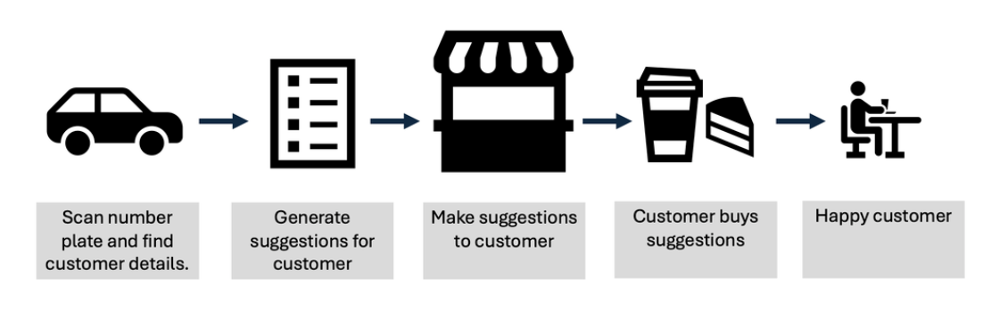

# IBM Integration

## Introduction
IBM webMethods Hybrid Integration allows the usage of many IBM integration capabilities within one SaaS system. This allows both tighter integration between the separate capabilities, and also a common way to administer and monitor the system.

Two key capabilities available within IBM webMethods Hybrid Integration are;

    IBM App Connect
    IBM webMethods Integration 

The IBM webMethods Hybrid Integration allows the usage and configuration of both capabilities. It also gives a common monitoring and administration view to help run the system and debug their function.

[Return to main lab section](../index.md#lab-section)

This lab will take you through how to connect App Connect remote runtimes into webMethods Hybrid Integration. Once connected it will show how they can be monitored and administered. It will also show how integration logic can be split between the IBM managed runtimes and any external customer provided runtimes.

This lab is based on article that was created by **John Reeve**.  You can take a look at this for more info --> [Managing and utilizing App Connect runtimes in IBM webMethods Hybrid Integration](https://community.ibm.com/community/user/blogs/john-reeve1/2025/06/25/managing-and-utilizing-app-connect-runtimes-in-ibm)

[Return to main lab section](../index.md#lab-section)

# Table of Contents
- [1. Introduction](#introduction)

- [2. Scenario](#scenario)

- [2. Deploying the REST Service](#deploy)

- [3. Import an API into the Developer Workspace](#import_api)

- [4. Configure the API ](#configure_api)
    * [3a. Configure Client Secret API Key Security](#configure_security)
    * [3b. Review and update the Target-URL for Sandbox Environment](#target_url)
    * [3c. Review the Proxy Call in Designer](#proxy)

# 1. Introduction 

To illustrate how powerful and flexible the new webMethods Hybrid Integration is, I will use a scenario which requires calling integration logic, both running in the IBM managed infrastructure, and running in customer-managed runtimes.
# 2. Scenario 

A coffee shop owner tracks customer arrivals by capturing their car number plates and mapping them to user profiles. When a customer drives to the shop, their profile is retrieved, and an AI analytics tool analyses their past preferences. Based on this data, the AI tool generates personalized menu suggestions. The number plate mechanism is available in a cloud managed system and the AI mechanism is running on an on-premise system completely self-managed by the customer.

When constructing the above scenario the integration will need access to integrations running in both these systems.
Scenario

[Return to main lab section](../index.md#lab-section)
